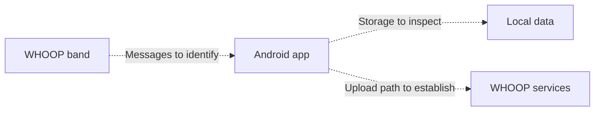

# Investigate a WHOOP sync

Use this workflow to answer: **which messages move between a WHOOP band and
its Android app during a normal sync, and which app methods handle them?**
It composes existing REA tools. It is an investigation recipe, not a verified
WHOOP protocol implementation. No WHOOP APK or physical capture has been
analysed for this guide.

## Inputs and prerequisites

- Your Android phone with WHOOP installed and your paired band.
- Record phone model, Android release/API level, app version, band model and
  firmware version. Keep unknown values explicitly unknown.
- A computer with an existing REA installation, a supported Node.js version,
  Android platform-tools `adb`, and the JDK/JADX prerequisites in the
  [Android guide](android-analysis.md#supply-tools).
- Packet inspection uses an existing TShark 4.x on Linux and `prlimit`; see
  [packet captures](packet-captures.md). A Pixel can collect the recording while
  a separate Linux machine analyses it.

Use a private working directory outside the repository for APKs, bug reports,
captures, tool results and the filled-in [report template](whoop-sync-report.md).
Bug reports include unrelated phone information. Share the selected Bluetooth
recording and reviewed findings rather than publishing the entire bug report.
Record SHA-256 hashes and preserve the original inputs when creating derivatives.

## Acquire the installed app

On Windows, the standalone
[collection helper](https://github.com/LIAMSTAINTON21/rea/tree/docs/whoop-sync-investigation/examples/whoop)
automates APK copying and selected Bluetooth-log extraction using existing ADB.
It keeps the full bug report outside its sharing ZIP. Phone settings and the
normal sync remain explicit user steps. The commands below are the manual path.

Enable USB debugging on your phone and approve your computer's connection.
Use the serial returned by `list-adb-devices`; select the package from the
resolver output rather than guessing its identifier. All values below marked
`REPLACE_...` must be replaced with observed values or your chosen local path.
Commands assume a POSIX shell. Choose a fresh acquisition output directory.

```sh
rea inspect-adb-client --json
rea list-adb-devices --json
serial='REPLACE_WITH_DEVICE_SERIAL'
rea resolve-adb-packages "$serial" whoop --json
package='REPLACE_WITH_RESOLVED_PACKAGE'
rea inspect-adb-package "$serial" "$package" --json
rea pull-adb-package "$serial" "$package" \
  --output-directory /absolute/private/whoop/apk-acquisition --json
```

Retain the complete acquired APK set. Select the base APK path returned by the
acquisition. REA's static Android analysis does not merge split APKs; absence
from the base APK cannot establish absence from the installed application.
Inspect relevant split APKs separately if the provider accepts them, recording
their individual hashes and coverage. See [ADB acquisition](adb-device-analysis.md).

## Map candidate code paths

```sh
apk='/absolute/private/whoop/apk-acquisition/REPLACE_WITH_BASE_APK_PATH'
rea inspect-android-package "$apk" --json
rea search-android-classes "$apk" Bluetooth --json
rea search-android-classes "$apk" Sync --json
rea search-android-classes "$apk" Gatt --json
```

These searches match **case-sensitive class-name substrings**, not arbitrary
strings or method bodies. Empty results may reflect obfuscation or different
naming. An empty query inventories all names; use it only when the narrower
searches do not supply useful candidates.

Choose exact class and method names from the results:

```sh
class='REPLACE_WITH_OBSERVED_CLASS'
method='REPLACE_WITH_OBSERVED_METHOD'
rea inspect-android-class "$apk" "$class" --json
rea inspect-android-method "$apk" "$class" "$method" --json
rea trace-android-references "$apk" "$class" --method-name "$method" --json
```

If the method is overloaded, use the returned overload index with
`--overload-index` on inspection and reference tracing. Preserve the DEX
descriptor, APK hash and engine identity alongside each finding. Decompiled
source is derived evidence; references do not establish that a method ran.

Look for service/characteristic UUIDs, notification handlers, write operations,
packet assembly, sequence numbers, timestamps, local persistence and upload
scheduling. Describe these as candidates until confirmed by code and captures.
Do not assign meanings to bytes solely because their values look plausible.

## Record one sync on a Pixel

1. Record the app and band versions and the phone's current time and time zone.
2. In Android Developer options, enable **Bluetooth HCI snoop log**. Restart
   Bluetooth so logging takes effect, then allow the band to reconnect.
3. Note the start time. Leave the app idle briefly to obtain a baseline.
4. Open WHOOP and allow a normal sync. Note when syncing starts, when its
   status changes, and when it completes. Keep other interactions minimal.
5. Collect a bug report while the recording is still available:

   ```sh
   adb -s "$serial" bugreport /absolute/private/whoop/bugreport-sync.zip
   ```

6. Inspect the ZIP inventory for a Bluetooth snoop log, commonly under
   `FS/data/misc/bluetooth/logs/`. Extract the actual entry into your private
   directory. Location and inclusion depend on Android/OEM build; an absent
   log is a capture gap, not evidence of absent Bluetooth traffic.
7. Disable HCI logging after collection. Record any Bluetooth restart and
   reconnect as part of the experiment because they affect the trace.

[Android's Bluetooth debugging documentation](https://source.android.com/docs/core/connect/bluetooth/verifying_debugging)
also describes extracting a snoop recording from a text bug report with
`btsnooz.py`. In-memory logs may omit payloads; check the resulting capture's
coverage before using it to infer the sync protocol. This workflow does not
require rooting the phone.

HCI logs observe the phone/controller boundary. They do not guarantee that
application-level payloads are plaintext or expose HTTP requests to the cloud.

## Inspect the recording

Discover the installed TShark fields before using them:

```sh
rea inspect-packet-fields --kind fields --protocol btatt --all --json
```

If the glossary includes the fields below, use this first bounded view:

```sh
capture='/absolute/private/whoop/REPLACE_WITH_SNOOP_LOG'
rea inspect-packet-capture "$capture" \
  --fields frame.time_epoch --fields btatt.opcode --fields btatt.handle \
  --display_filter btatt --match_limit 50 --json
```

`frame.number` is always included. Page using `--match_offset` and keep the
capture digest unchanged across pages. Discover and select the relevant UUID,
value and connection fields from the glossary as needed. Keep payload views
limited to the connection and time interval under investigation.

An ATT handle is scoped to a connection's discovered attribute table; do not
assume it identifies the same characteristic in another recording. Associate
handles with observed service discovery and UUIDs. If discovery is missing,
leave that mapping unresolved. A filter selecting all ATT packets can include
other devices: establish the WHOOP connection before attributing frames.

No ATT matches can mean incomplete logging, an unsupported encapsulation,
filter mismatch or another transport. Preserve those possibilities. This
recipe has not established real WHOOP/TShark compatibility.

## Correlate evidence and report

Copy the [report template](whoop-sync-report.md) into your private workspace.
For each proposed message meaning, record both the original frame numbers and
the exact app method/descriptor supporting the interpretation. Record time-zone
and clock-alignment uncertainty when connecting UI events to capture times.

Use this as a question map, not an observed architecture:



Repeat a normal sync once to distinguish repeatable behaviour from the first
reconnection. Preserve both recordings. A useful first result identifies at
least one message exchange, its handler and the evidence linking them, or
explains precisely why the capture/code cannot yet establish that relationship.

Cloud upload behaviour needs separate network or app evidence. WHOOP's
[public API](https://developer.whoop.com/api/) documents access to scored sleep,
recovery, cycle and workout data; it does not document the band's internal sync
protocol. The [WHOOP developer FAQ](https://developer.whoop.com/docs/developing/support/)
distinguishes BLE heart-rate broadcasting from API data access. Treat a
heart-rate broadcast as a separate experiment from historical-data syncing.

An AWS Cognito user-agent identifies a claimed client/library context, not a
specific upload endpoint or proof that health data uses that service. Server-side
scoring cannot be reconstructed from client code alone.
